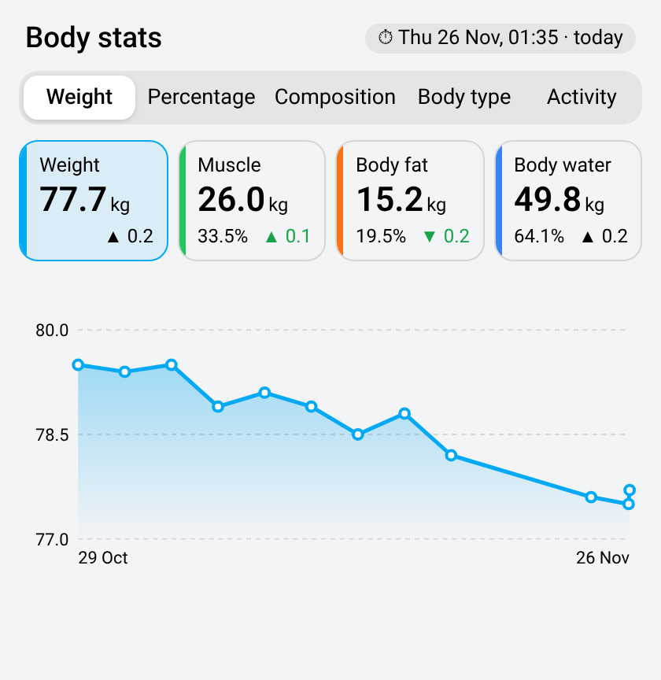
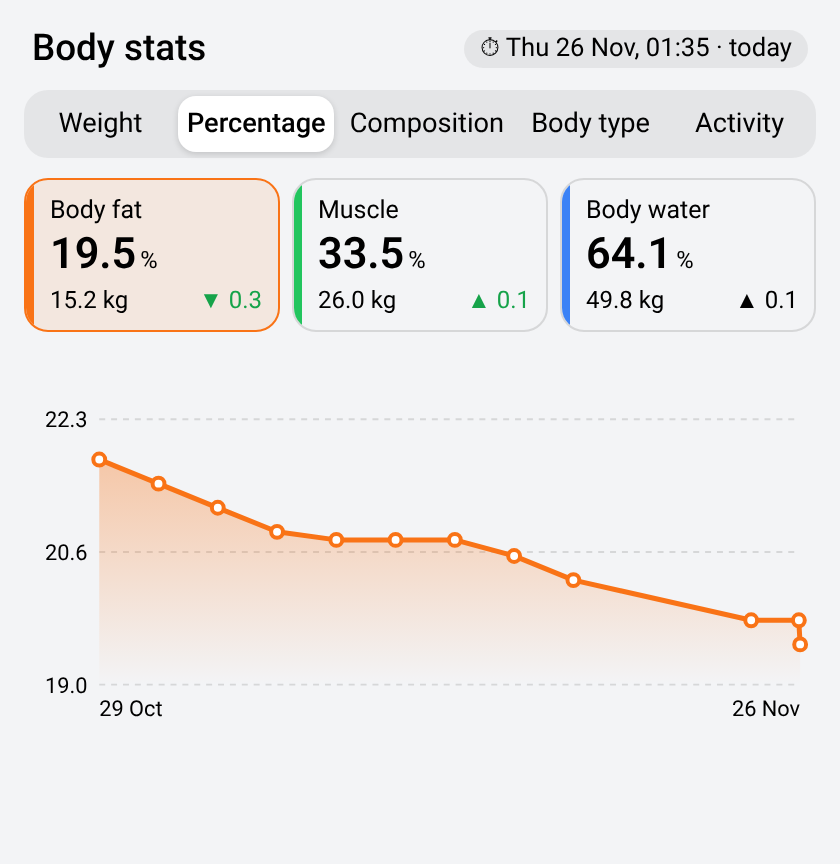
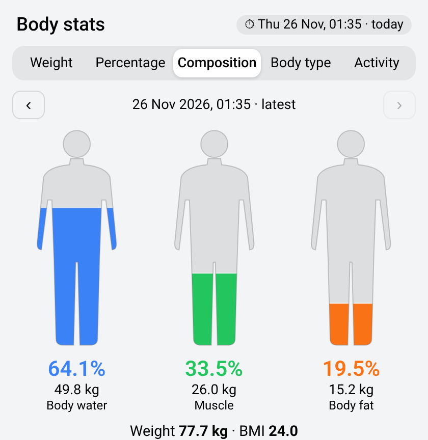
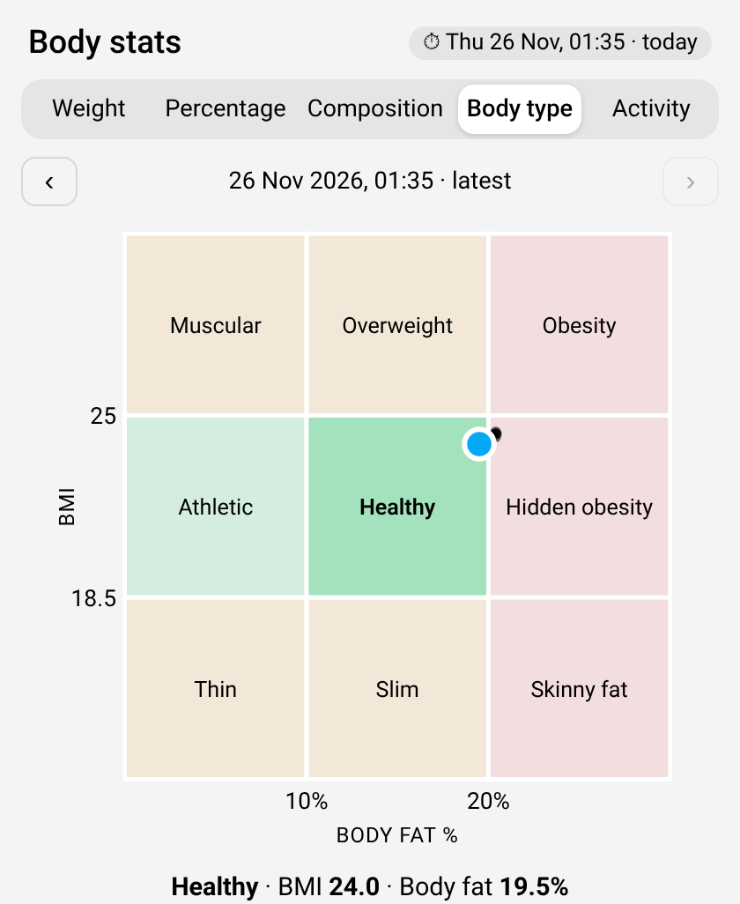
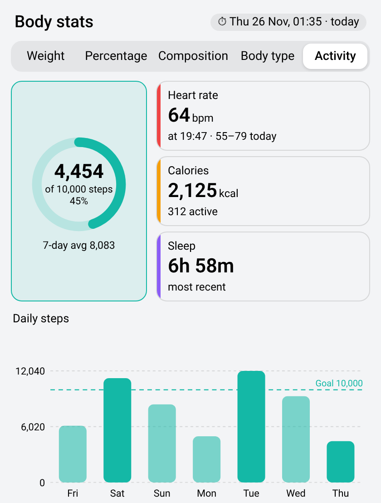
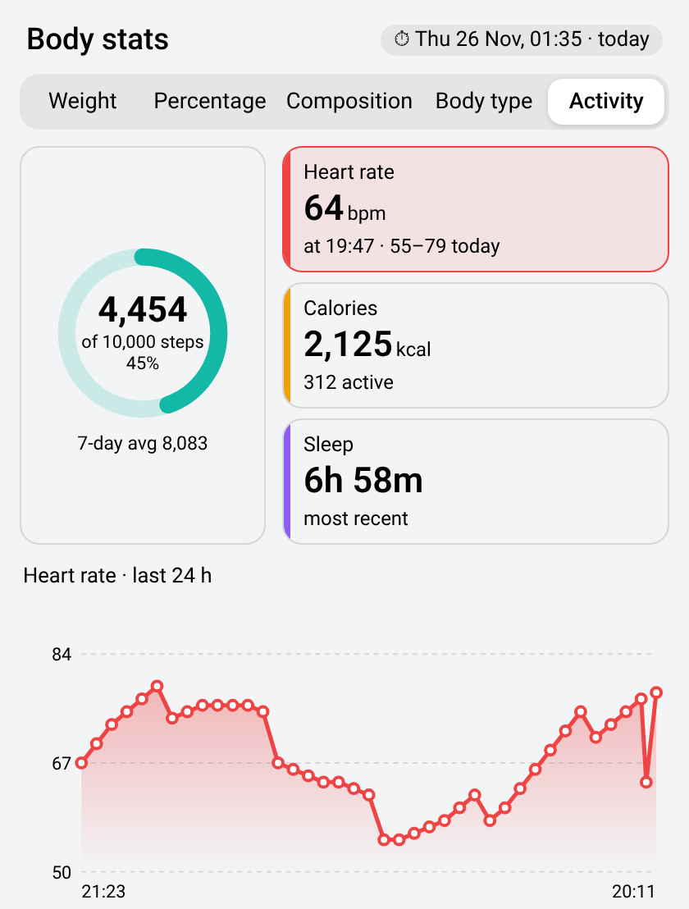
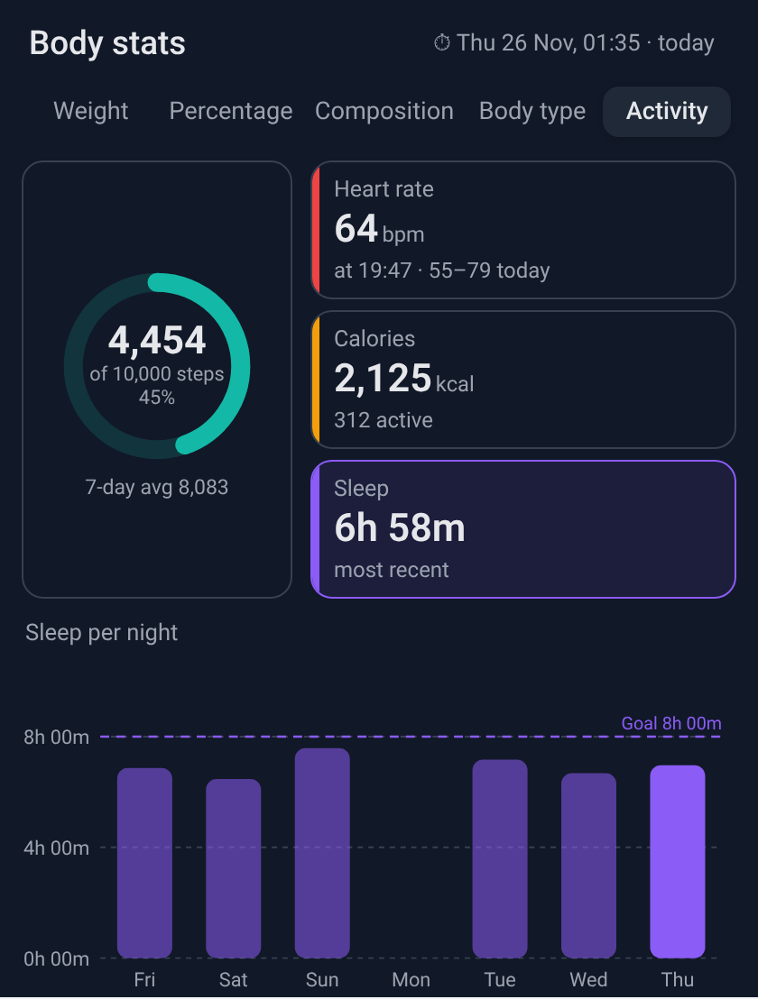
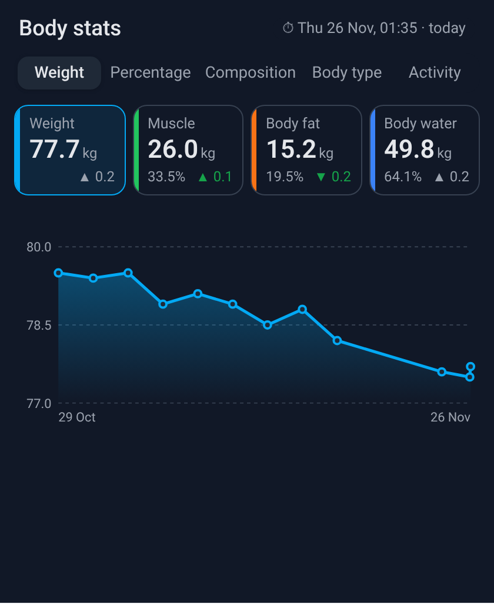
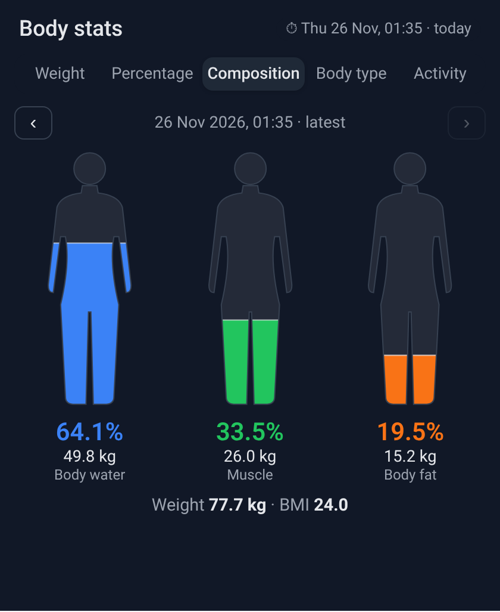

# Body Stats Card

An InBody-style body composition and activity card for Home Assistant. It works with any smart scale that exposes weight plus body fat, muscle and/or body water sensors, and with step, heart-rate, calorie and sleep sensors such as those from the Home Assistant Companion app's Health Connect sensors. It was built for a Salter MiBody scale read by [esphome-salter-mibody](https://github.com/johnradford49/esphome-salter-mibody).

| Weight | Percentage | Composition | Body type |
|---|---|---|---|
|  |  |  |  |

| Activity: steps | Activity: heart rate | Activity: sleep (dark) |
|---|---|---|
|  |  |  |

| Dark theme | |
|---|---|
|  |  |

_Screenshots use sample data._

## Features

- **Weight tab:** weight, muscle, body fat and body water in kg, each with the change since the previous weigh-in. Muscle going up and fat going down show green. Tap a tile to switch the trend graph to that measurement, and tap it again to open its history.
- **Percentage tab:** the same components as a percentage of body weight, with a trend graph.
- **Composition tab:** male or female figures filled to each component's percentage, with arrows to step through past weigh-ins.
- **Body type tab:** BMI plotted against body fat on a 3 × 3 grid (Thin, Slim, Skinny fat, Athletic, Healthy, Hidden obesity, Muscular, Overweight, Obesity), with a trail of recent weigh-ins.
- **Activity tab:** a ring showing today's steps against your goal, tiles for heart rate (latest reading and today's range), calories (total and active) and last night's sleep. Tap a tile to chart it: daily steps with a goal line, heart rate over the last 24 hours, calories per day, or sleep per night against an 8-hour goal.
- **Last weigh-in badge** that turns orange after 7 days and red after 30.
- Works with sensors in either `%` or `kg`. The card converts between them using the weight.
- Uses recorder history for individual weigh-ins and falls back to long-term statistics (daily means) for older data.
- Collapses the repeated readings that Bluetooth scales send when they reconnect, so each weigh-in appears once.
- Visual editor, light and dark themes, no dependencies.

## Installation

### Marketplace / HACS (custom repository)

1. Open **Settings → Marketplace** (or **HACS** on Home Assistant 2026.10 and older).
2. Choose **Add from link** (HACS: ⋮ → **Custom repositories**). Add `https://github.com/johnradford49/body-stats-card` as a **Dashboard** / **Plugin**.
3. Install **Body Stats Card**, then hard-refresh your browser.

### Manual

1. Copy `body-stats-card.js` to `/config/www/body-stats-card.js`.
2. Go to **Settings → Dashboards → ⋮ → Resources → Add resource**. Enter URL `/local/body-stats-card.js?v=1.1.0` with type **JavaScript module**.
3. Hard-refresh your browser. When you update the file, bump the `?v=` number so browsers fetch the new copy.

## Configuration

Add it from **Add card → Body Stats** and use the visual editor, or in YAML:

```yaml
type: custom:body-stats-card
title: Body stats
weight_entity: sensor.salter_weight
fat_entity: sensor.salter_body_fat
muscle_entity: sensor.salter_muscle
water_entity: sensor.salter_body_water
height_cm: 180
body_type: male
days_to_show: 90
# activity (optional)
steps_entity: sensor.phone_daily_steps
steps_goal: 10000
heart_rate_entity: sensor.phone_heart_rate
calories_entity: sensor.phone_total_calories_burned
active_calories_entity: sensor.phone_active_calories_burned
sleep_entity: sensor.phone_sleep_duration
```

The Activity tab appears when at least one activity sensor is set. If you leave out `weight_entity`, the card shows only the Activity tab.

| Option | Default | Description |
|---|---|---|
| `weight_entity` | – | Weight sensor in kg. Needed for the body tabs. Set this or at least one activity sensor |
| `fat_entity` | – | Body fat sensor (`%` or `kg`) |
| `muscle_entity` | – | Muscle sensor (`%` or `kg`) |
| `water_entity` | – | Body water sensor (`%` or `kg`) |
| `height_cm` | – | Your height. Needed for BMI and the Body type tab |
| `body_type` | `male` | `male` or `female`. Sets the figure and the body-fat ranges on the Body type grid |
| `title` | – | Card title |
| `days_to_show` | `90` | How far back to load weigh-ins |
| `tabs` | all available | Any of `weight`, `percentage`, `composition`, `quadrant`, `activity` |
| `default_tab` | first tab | Tab shown when the card loads |
| `show_graph` | `true` | Show the graph on the Weight, Percentage and Activity tabs |
| `steps_entity` | – | Daily steps sensor (resets each day) |
| `steps_goal` | `10000` | Daily step goal for the ring and the goal line |
| `heart_rate_entity` | – | Heart rate sensor in bpm |
| `calories_entity` | – | Total calories burned today |
| `active_calories_entity` | – | Active calories burned today |
| `sleep_entity` | – | Sleep duration sensor (`min`, `h` or `s`) |
| `sleep_goal_hours` | `8` | Goal line on the sleep chart |
| `activity_days` | `7` | Days shown in the steps, calories and sleep charts (3–31) |

### Keeping more than ~10 days of history

Home Assistant keeps detailed history for 10 days by default. After that, the card can only use long-term statistics, which are recorded only for sensors with a `state_class`. If your scale's sensors have no `state_class: measurement`, add it in the ESPHome config (or with `homeassistant: customize:`) so their long-term trends are kept.

### Body type ranges

| | Low | Normal | High |
|---|---|---|---|
| BMI | < 18.5 | 18.5 – 25 | ≥ 25 |
| Body fat (male) | < 10% | 10 – 20% | ≥ 20% |
| Body fat (female) | < 18% | 18 – 28% | ≥ 28% |

These are general reference ranges, not medical advice.

## Credits

The layout is inspired by the card bundled with [ha-inbody](https://github.com/jacardbr/ha-inbody). This card is a separate implementation that works with any scale's sensors.

## License

MIT
